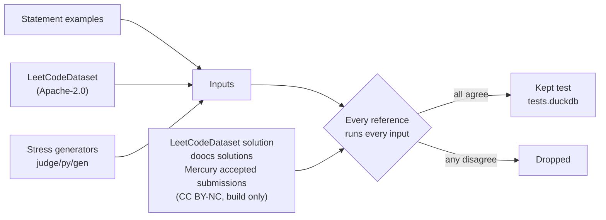
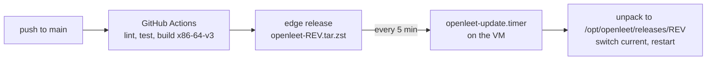

# OpenLeet

Flashcards and a Python judge for the LeetCode problems top tech companies ask, plus every free
problem from 1 to 1000. Live: https://openleet.sudhanva.me

## How it fits together


## A submission

```mermaid
sequenceDiagram
    participant W as Web app
    participant S as openleet
    participant J as openleet-judge
    participant Z as zygote
    participant C as child
    W->>S: POST /api/submit {slug, code}
    S->>S: load tests (one row group)
    S->>J: code + inputs + expected outputs
    J->>Z: code + inputs (never the answers)
    Z->>Z: build inputs, generate stress tests
    Z->>C: fork
    loop each test
        C-->>J: output
        J->>J: compare; stop at first failure
    end
    J->>J: watchdog kills at the CPU limit
    J-->>S: verdict, passed/total, CPU ms
    S->>S: store in DuckDB
    S-->>W: Accepted / Wrong Answer / TLE / ...
```

## Where the tests come from



A reference counts only if it reproduces the statement's own example outputs. The time limit is
at least 4× the fastest reference and 1.25× the slowest, so what LeetCode accepted passes here.
Rebuild with `uv run openleet judge all`.

Sources: company lists from
[liquidslr/leetcode-company-wise-problems](https://github.com/liquidslr/leetcode-company-wise-problems),
statements from [doocs/leetcode](https://github.com/doocs/leetcode) (CC BY-SA 4.0, no premium
statements), approaches and hints written by Claude agents and reviewed with Codex CLI
(`data/approach-reviews.json`).

## Releases



Roll back by pointing `/opt/openleet/current` at an older release. New server: copy `deploy/`,
run `sudo deploy/install.sh`, fill in `/etc/openleet.env`, run `sudo /opt/openleet/update.sh`.

## Run locally

The judge needs Linux, so on macOS it runs in Docker:

```bash
uv sync && bun install && bun run build
docker compose up -d judge
JUDGE_SOCKET=tcp://127.0.0.1:7777 JUDGE_CPU_SCALE=1 cargo run --release -p openleet
# http://localhost:8080   (bun run dev: web on :3000 with hot reload)
```

```bash
bun run check && bun run typecheck && bun run test
cargo clippy --all-targets && cargo test
uv run ruff check && uv run ty check
```

```
server/  Rust API + web app     judge/   judge daemon + judge/py sandbox
proto/   shared wire types      web/     React SPA
src/     Python data tools      data/    problems, approaches, judge specs and tests
deploy/  systemd units, install and update scripts
```

## API

| Method and path | Does |
| --- | --- |
| `GET /api/companies` | Companies and their problem counts |
| `GET /api/problems?company=meta&period=3m` | One list with your progress |
| `GET /api/problems/:slug` | One card: statement, topics, companies, approach |
| `GET /api/deck?company=&period=&set=&topic=&difficulty=` | Next card (`period`: `30d`, `3m`, `6m`, `all`, `lc1000`) |
| `GET /api/search?q=two+sum` | Search by number, title, topic or statement |
| `POST /api/attempts` `{slug, grade, guessed, hints}` | Grade or skip a card |
| `PUT /api/notes` `{slug, text}` | Save your answer |
| `DELETE /api/progress?slug=` or `?all=true` | Clear progress |
| `GET /api/report?company=` | Readiness, streak, weak topics, trend |
| `GET /api/code/:slug` | Starter, draft, previous version, examples, time limit |
| `PUT /api/drafts`, `POST /api/drafts/reset`, `POST /api/drafts/restore` | Save, reset or restore code |
| `POST /api/run` `{slug, code, input?}` | Run examples or your own input |
| `POST /api/submit` `{slug, code}` | Run every test |
| `GET /api/submissions?slug=` | Your submissions |

## Keys

`Enter` answer · `H` hint · `S` skip · `1` again · `2` got it · `3` less often · `B` back ·
`M` my answer · `/` search · ⌘Enter run · ⌘⇧Enter submit
