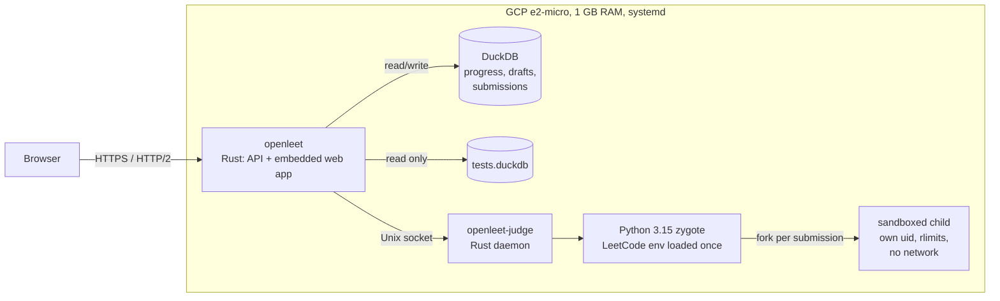
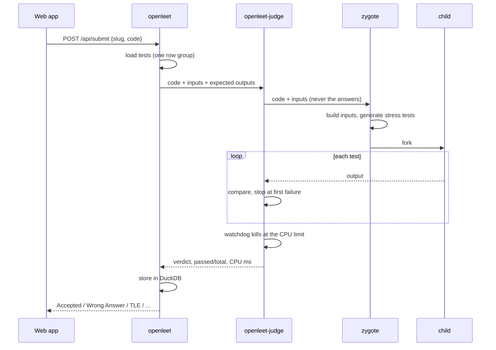
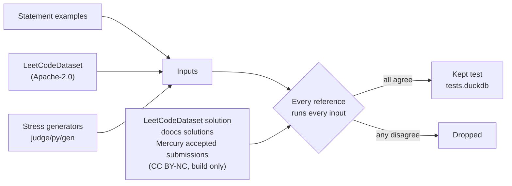
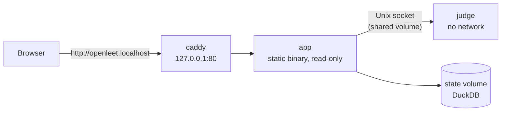
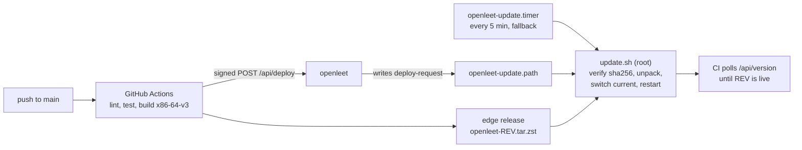

# OpenLeet

OpenLeet is a web app for practicing LeetCode problems with spaced-repetition flashcards and a
sandboxed Python 3.15 judge. It covers the problems top tech companies ask (30 days, 3 months, 6
months, and all time) plus every free problem from 1 to 1000. Live: <https://openleet.sudhanva.me>

## Architecture



A page loads in one round trip: `index.html` inlines the stylesheet and static shell, and the
server adds preload links for the route's code and its first API calls (`server/src/preload.rs`) so
code and data download together.

### Judging a Submission



The time limit is the larger of 4× the fastest reference and 1.25× the slowest, multiplied by
`JUDGE_CPU_SCALE` (3.25 on the VM, which runs Python about 3× slower than a laptop), plus 500 ms,
clamped between 2 and 30 s. Each submission gets about 370 MB of heap before `Memory Limit Exceeded`.

### Test Corpus



A reference solution counts only if it reproduces the statement's example outputs. Rebuild the
corpus with `uv run openleet judge all`; `uv run openleet judge publish` uploads `tests.duckdb` to
the `corpus` release and pins its digest in `data/judge/corpus.json`.

## Quick Start



```bash
docker compose up -d                  # http://openleet.localhost (images from ghcr.io)
docker compose up -d --build          # or build both images from this checkout
HTTP_PORT=8088 docker compose up -d   # port 80 taken: http://openleet.localhost:8088
```

## Development

The judge requires Linux, so on macOS only the judge runs in Docker while the server and web app
run on the host:

```bash
uv sync && uv run openleet judge fetch && bun install && bun run build
docker compose --profile dev up -d judge-dev   # judge on 127.0.0.1:7777
JUDGE_SOCKET=tcp://127.0.0.1:7777 JUDGE_CPU_SCALE=1 cargo run --release -p openleet
# http://localhost:8080   (bun run dev runs the web app on :3000 with hot reload)
```

Run all CI checks (or install them as the `pre-push` hook with `uv run prek install`):

```bash
uv run prek run --all-files --hook-stage pre-push
```

`openleet smoke` tests a running server over HTTP with reference solutions, wrong and crashing
variants, time and memory limits, sandbox abuse, and bad requests. It restores every draft it
changes; its submissions stay in the history:

```bash
uv run openleet smoke --base-url http://localhost:8080 --allow-network   # local Docker judge
uv run openleet smoke --base-url https://openleet.sudhanva.me --seed 7 --json
```

```text
server/  Rust API + web app     judge/   judge daemon + judge/py sandbox
proto/   shared wire types      web/     React SPA
src/     Python data tools      data/    problems, approaches, judge specs and tests
deploy/  systemd units, install and update scripts
```

## Deployment



Every component on the VM is a `systemd` unit enabled at boot, so reboots and stop/start cycles
need no manual steps:

- `openleet-http.socket` and `openleet-https.socket` hold ports 80 and 443 so restarts drop no
  connections.
- `systemd` restarts the server if it exits or misses its watchdog ping (sent only while the
  database answers). `openleet-health.timer` restarts the server after 3 failed checks and the
  judge when it reports down.
- `rustls-acme` renews the TLS certificate 30 days before expiry.
- The database is copied to `/var/lib/openleet/backups/` daily (14 kept), and the server runs
  migrations (`server/src/db/migrations`) on startup. If the database file cannot be opened, the
  server quarantines it and restores the newest backup; if it opens and its pre-migration backup or
  a migration fails, the server stops and leaves the file in place.

Roll back by pointing `/opt/openleet/current` at an older release in `/opt/openleet/releases/` and
restarting the services. To set up a new Ubuntu server, copy `deploy/`, run
`sudo deploy/install.sh`, set `DEPLOY_SECRET` in `/etc/openleet.env` (matching the GitHub secret),
and run `sudo /opt/openleet/update.sh`.

## API

| Method and path | Description |
| --- | --- |
| `GET /api/companies` | Companies and their problem counts |
| `GET /api/problems?company=meta&period=3m&topic=&difficulty=&q=` | One list with your progress, filtered; `q` searches within it |
| `GET /api/topics?company=&period=&difficulty=` | The list's topics and their problem counts, most first |
| `GET /api/problems/:slug` | One card: statement, topics, companies, approach |
| `GET /api/deck?company=&period=&set=&topic=&difficulty=` | Next card (`period`: `30d`, `3m`, `6m`, `all`, `lc1000`; `topic` by name, `difficulty` `Easy`, `Medium`, or `Hard`; unknown values filter nothing) |
| `GET /api/search?q=two+sum` | Search by number, title, topic, or statement (`q` required) |
| `POST /api/attempts` `{slug, grade, guessed, hints}` | Grade or skip a card |
| `PUT /api/notes` `{slug, text}` | Save your answer |
| `DELETE /api/progress?slug=` or `?all=true` | Clear progress |
| `GET /api/report?company=` | Readiness, streak, weak topics, trend |
| `GET /api/code/:slug` | Starter, draft, previous version, examples, time limit |
| `PUT /api/drafts`, `POST /api/drafts/reset`, `POST /api/drafts/restore` | Save, reset, or restore code |
| `POST /api/run` `{slug, code, input?}` | Run examples or your own input |
| `POST /api/submit` `{slug, code}` | Run every test |
| `GET /api/submissions?slug=` | Your submissions |
| `GET /api/health` | `ok`, `db`, `judge`, certificate expiry; 503 when the database is down |
| `GET /api/version` | The running revision |

Errors return `{"error": "..."}` with HTTP 400 for invalid input (malformed JSON included), 404 for
an unknown problem or endpoint, and 415 for a body not sent as `application/json`.

## Keyboard Shortcuts

`Enter` answer · `H` hint · `S` skip · `1` again · `2` got it · `3` less often · `B` back ·
`M` my answer · `/` search · ⌘Enter run · ⌘⇧Enter submit

## Data Sources and License

- Company problem lists from
  [liquidslr/leetcode-company-wise-problems](https://github.com/liquidslr/leetcode-company-wise-problems).
- Problem statements (premium ones included) and solutions from
  [doocs/leetcode](https://github.com/doocs/leetcode) (CC BY-SA 4.0).
- Starter code, test inputs, and reference solutions from
  [LeetCodeDataset](https://huggingface.co/datasets/newfacade/LeetCodeDataset) (Apache-2.0).
- Accepted submissions from [Mercury](https://huggingface.co/datasets/Elfsong/Mercury) (CC BY-NC),
  used at build time only and never shipped.
- Approaches and hints written by Claude agents and reviewed with Codex CLI
  (`data/approach-reviews.json`).

Code is licensed under the [MIT License](LICENSE).
