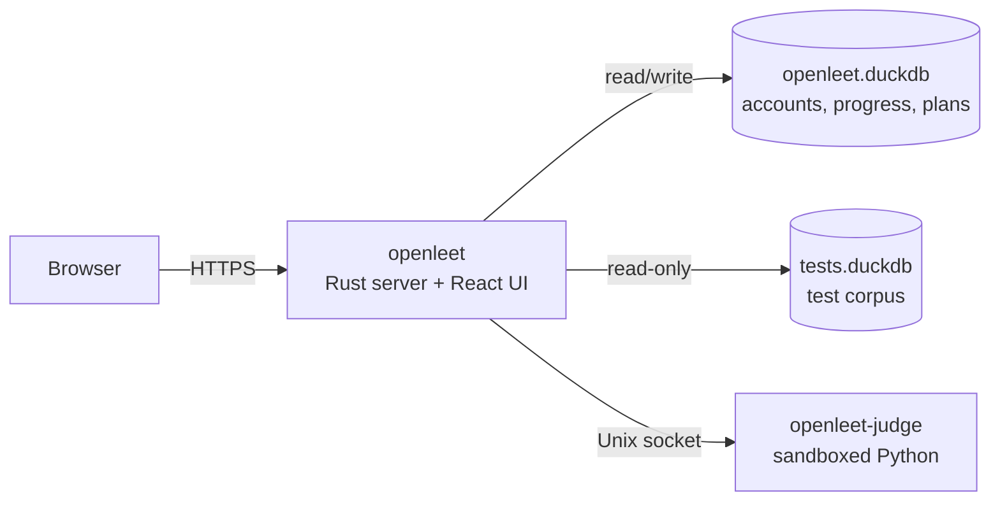

# OpenLeet

Self-hosted LeetCode practice app with company problem lists, spaced-repetition flashcards, and a
sandboxed Python judge. Supports multiple email/password accounts with isolated per-user progress.

[Live demo](https://openleet.sudhanva.me) · [Quick start](#quick-start) · [Documentation](docs/)

## Features

- Company-tagged problem lists for 24 tech companies (`30d`, `3m`, `6m`, `all`), plus all free
  LeetCode problems from 1 to 1000.
- Spaced-repetition flashcards for recalling problem topics, approaches, hints, and complexity.
- Sandboxed Python 3 judge that runs examples, hidden tests, and stress tests with LeetCode-style
  verdicts.
- Filterable practice plans (by company, topic, difficulty, status, and sort order) and custom
  problem lists.
- Readiness tracking across each company's top 100 problems (60% clean solves, 40% current
  flashcards), with daily trends, streaks, and weak-topic reports.
- Embedded YouTube walkthroughs prioritized by NeetCode, Greg Hogg, and view count.
- Multi-user email/password accounts with per-account progress and an admin toggle to close
  sign-ups.

## Quick start

### Docker

```bash
git clone https://github.com/nsudhanva/openleet && cd openleet
docker compose up -d
```

Open <http://openleet.localhost>. If port 80 is in use, set `HTTP_PORT=8088 docker compose up -d`
and open <http://openleet.localhost:8088>.

### Ubuntu server

On Ubuntu 24.04 with a domain pointed at the server and ports 80 and 443 open:

```bash
git clone https://github.com/nsudhanva/openleet && cd openleet
sudo SITE_ADDRESS=openleet.example.com deploy/install.sh
```

The installer configures systemd units, provisions a Let's Encrypt TLS certificate for
`https://openleet.example.com`, and enables automatic release updates. See
[Deployment](docs/deployment.md#new-server) for configuration options.

### First-time setup

A fresh instance starts with no accounts and writes a one-time setup code to its state directory.
Read the code, open `/login`, select **Create account**, and register the initial admin account:

```bash
# Docker
docker compose cp app:/state/setup-code - | tar -xO

# Ubuntu server
sudo cat /var/lib/openleet/setup-code
```

Once the admin account exists, anyone can register until the admin disables sign-ups on the
**Account** page. See [Deployment](docs/deployment.md#initial-admin-setup) for details.

## Architecture



Compiled to a single Rust binary (Axum with an embedded React frontend), backed by DuckDB and an
isolated Linux judge daemon that fits in a 1 GB VM.

## Documentation

| Document | Description |
| --- | --- |
| [Architecture](docs/architecture.md) | Server internals, auth model, judge sandbox, time limits, and test corpus pipeline |
| [Development](docs/development.md) | Local setup from source, linters, tests, and smoke tests |
| [Deployment](docs/deployment.md) | Production systemd setup, initial admin setup, backups, rollbacks, and forks |
| [API](docs/api.md) | REST endpoints, authentication, rate limits, readiness formula, and report schema |

## Data sources

| Data | Source | License |
| --- | --- | --- |
| Company lists | [liquidslr/leetcode-company-wise-problems](https://github.com/liquidslr/leetcode-company-wise-problems) | — |
| Statements & solutions | [doocs/leetcode](https://github.com/doocs/leetcode) | CC BY-SA 4.0 |
| Starter code, tests & solutions | [LeetCodeDataset](https://huggingface.co/datasets/newfacade/LeetCodeDataset) | Apache-2.0 |
| Build-time test verification (not shipped) | [Mercury](https://huggingface.co/datasets/Elfsong/Mercury) | CC BY-NC |
| Video links | [neetcode-gh/leetcode](https://github.com/neetcode-gh/leetcode) & [yt-dlp](https://github.com/yt-dlp/yt-dlp) | — |
| Approaches & hints | Generated and reviewed (`data/approach-reviews.json`) | MIT |

## License

[MIT](LICENSE). Problem statements from `doocs/leetcode` remain under CC BY-SA 4.0.
