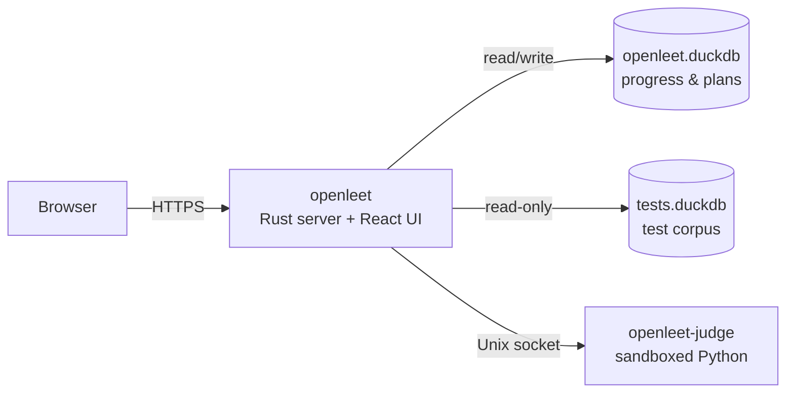

# OpenLeet

Self-hosted LeetCode practice app with company problem lists, flashcards, and a Python judge.
No accounts; progress is stored on the server.

[Live demo](https://openleet.sudhanva.me) · [Quick start](#quick-start) · [Docs](docs/)

## Features

- **Company lists**: 24 top tech companies filtered by recency (`30d`, `3m`, `6m`, `all`), plus
  all free problems from 1 to 1000.
- **Spaced-repetition flashcards**: Recall a problem's topics, then check the approach, hints, and
  complexity. Reviews are scheduled automatically.
- **Sandboxed Python judge**: Run code against examples, hidden tests, and stress tests with
  LeetCode-style verdicts.
- **Practice plans & custom lists**: Filter by company, topic, difficulty, status, and sort order;
  pin plans or build custom problem lists.
- **Readiness & progress**: Weighted readiness score (60% clean solves, 40% current flashcards)
  across a company's top 100 problems, with daily trends, streaks, and weak-topic tracking.
- **Video explanations**: Embedded YouTube walkthroughs prioritized by NeetCode, Greg Hogg, and
  top-viewed explanations.

## Quick start

### Docker

```bash
git clone https://github.com/nsudhanva/openleet && cd openleet
docker compose up -d
```

Open <http://openleet.localhost>. If port 80 is in use, set `HTTP_PORT=8088 docker compose up -d`
and open <http://openleet.localhost:8088>.

### Ubuntu server (auto-HTTPS + auto-updates)

On an Ubuntu 24.04 machine with a domain pointed at it and ports 80/443 open:

```bash
git clone https://github.com/nsudhanva/openleet && cd openleet
sudo SITE_ADDRESS=openleet.example.com deploy/install.sh
```

This sets up systemd units, gets a Let's Encrypt certificate for `https://openleet.example.com`,
and automatically pulls new releases. See [Deployment](docs/deployment.md#new-server) for options.

## How it works



Single Rust binary (Axum + embedded React frontend), DuckDB for state, and an isolated Linux judge
daemon that runs on a 1 GB VM.

## Documentation

| Doc | What it covers |
| --- | --- |
| [Architecture](docs/architecture.md) | Server internals, judge sandbox, time limits, and test corpus pipeline |
| [Development](docs/development.md) | Running from source, linters, tests, and smoke tests |
| [Deployment](docs/deployment.md) | Production systemd setup, backups, rollbacks, and forks |
| [API](docs/api.md) | JSON endpoints, readiness formula, and report schema |

## Data sources

- **Company lists**: [liquidslr/leetcode-company-wise-problems](https://github.com/liquidslr/leetcode-company-wise-problems)
- **Statements & solutions**: [doocs/leetcode](https://github.com/doocs/leetcode) (CC BY-SA 4.0)
- **Starter code, tests & solutions**:
  [LeetCodeDataset](https://huggingface.co/datasets/newfacade/LeetCodeDataset) (Apache-2.0)
- **Build-time test verification (not shipped)**:
  [Mercury](https://huggingface.co/datasets/Elfsong/Mercury) (CC BY-NC)
- **Videos**: [neetcode-gh/leetcode](https://github.com/neetcode-gh/leetcode) and YouTube search via
  [yt-dlp](https://github.com/yt-dlp/yt-dlp) (`uv run openleet videos` writes `data/videos.json`)
- **Approaches & hints**: Generated and reviewed (`data/approach-reviews.json`)

## License

[MIT](LICENSE). Problem statements from `doocs/leetcode` remain under CC BY-SA 4.0.
