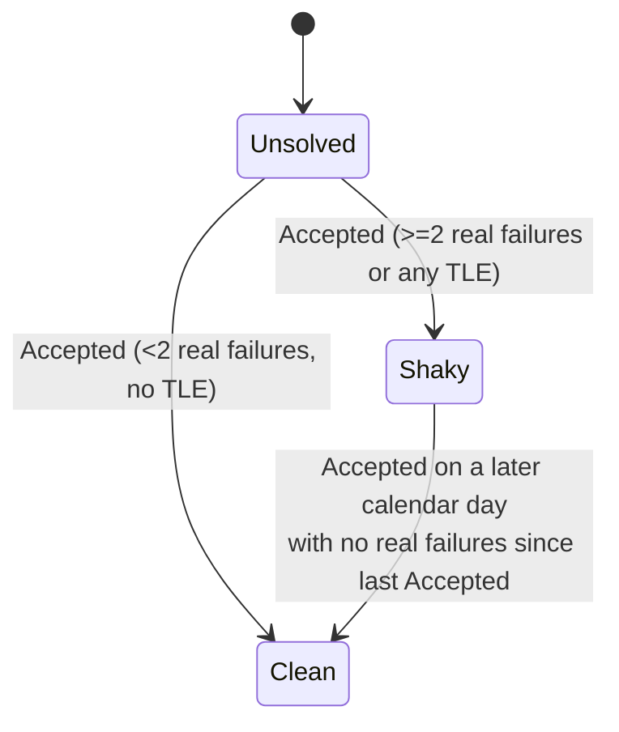

# API

All endpoints live under `/api` and return JSON.

## Endpoints

### Problems & flashcards

| Endpoint | Description |
| --- | --- |
| `GET /companies` | Companies and problem counts |
| `GET /problems?company=&period=&list=&topic=&difficulty=&status=&order=&q=` | Filtered problem list with user progress |
| `GET /topics?company=&period=&difficulty=` | Topics in the filtered list with counts, most frequent first |
| `GET /problems/:slug` | Problem details: statement, topics, companies, approach, videos |
| `GET /deck?company=&period=&set=&topic=&difficulty=` | Next flashcard to review |
| `GET /search?q=` | Search by problem number, title, topic, or statement text |
| `POST /attempts` `{slug, grade, guessed, hints}` | Grade or skip a flashcard |
| `PUT /notes` `{slug, text}` | Save personal notes for a problem |
| `DELETE /progress?slug=` or `?all=true` | Clear progress for one problem or everything |

### Coding & judge

| Endpoint | Description |
| --- | --- |
| `GET /code/:slug` | Starter code, saved draft, time limit, and examples (one JSON value per line) |
| `PUT /drafts`, `POST /drafts/reset`, `POST /drafts/restore` | Save, reset, or restore editor code |
| `POST /run` `{slug, code, input?}` | Run against examples or custom input |
| `POST /submit` `{slug, code}` | Run full test suite; returns verdict, CPU time vs. limit, and intended complexity |
| `GET /submissions?slug=` | Submission list for a problem |
| `GET /submissions/:id` | Single submission with code and result (kept for newest 100 per problem plus latest Accepted) |

### Plans & custom lists

| Endpoint | Description |
| --- | --- |
| `GET /next?slug=&company=&period=&list=&topic=&difficulty=&status=&order=` | Next problem after `slug`, plan progress, and up to 4 related plans (omits topics to avoid spoiling flashcards) |
| `GET /plans` | Pinned plans followed by recent plans, each with progress and next problem |
| `PUT /plans` `{company, period, topic, difficulty, status, order}` | Record a used plan and return it |
| `PATCH /plans/:id` `{name?, pinned?}` | Rename (`null` clears name) or pin/unpin a plan |
| `DELETE /plans/:id` | Delete a plan |
| `GET /lists` | Custom lists, newest first, with problems, progress, and next problem |
| `POST /lists` `{name, slugs?}` | Create a custom list |
| `PATCH /lists/:id` `{name?, slugs?}` | Rename a list or replace its ordered `slugs` |
| `DELETE /lists/:id` | Delete a list (problems and progress are kept) |

### Progress & system

| Endpoint | Description |
| --- | --- |
| `GET /report?company=` | Full progress report and coding insights (see [The report](#the-report)) |
| `GET /readiness?company=` | Readiness score alone, for the page header |
| `GET /health` | Database, judge, and TLS cert status (`503` if the database is down) |
| `GET /version` | Running git revision |

### Query parameters & limits

| Parameter | Values |
| --- | --- |
| `period` | `30d`, `3m`, `6m`, `all`, `lc1000` |
| `difficulty` | `Easy`, `Medium`, `Hard` |
| `status` | `unsolved` (no Accepted), `untried` (no submission), `shaky`, `all`. Defaults to `unsolved` in plans and `all` in problem lists. |
| `order` | `rank` (default list order), `number`, `easy-first`, `random` (deterministic shuffle) |
| `list` | Custom list ID. Overrides company list in `/problems` and `/next`; `rank` matches insertion order. |

Unknown filter values are ignored.

- **Plans**: Up to 8 recent unpinned plans and 50 pinned plans; names are 1 to 60 characters.
  Custom lists aren't duplicated into `/plans`.
- **Lists**: Up to 50 custom lists, 1,000 unique problems per list; names are 1 to 60 characters.

## The report

`GET /report?company=` (pass `any` for all companies) returns `report` and coding insights. Each
metric uses one of three scopes: the company's most-asked problems (readiness), its 6-month list,
or all activity across any list. All days use the server's timezone.

### `report` fields

| Field | Scope | Contents |
| --- | --- | --- |
| `readiness` | Most asked | Same object as `GET /readiness` |
| `trend` | Most asked | `{practiceDays, points}`: daily `{day, readiness}` from first practice (max 90 days back) to today, omitting days without data. `points` stays empty until `practiceDays >= 7`. |
| `counts` | 6-month list | Card counts: `due`, `new`, `again`, `less` |
| `byDifficulty` | 6-month list | `{difficulty, seen, total}`: cards graded at least once per difficulty |
| `accuracy` | Any list | Mean topic F1 score over the last 50 graded cards (`null` if none) |
| `graded` | Any list | Total graded cards, excluding skips |
| `streakDays` | Any list | Consecutive days with a graded card or submission, ending today or yesterday |
| `topics` | Any list | Weakest topics first: `{topic, score, named, seen}`. Rated once `seen >= 5` and shown only when `score < 0.6`, where `score = named / (named + (misses + false_alarms) / 2)`. |

### Readiness formula

`GET /readiness?company=` returns `{score, period, problems, recent, solved, shaky, cards, fading}`.
It covers up to 100 most-asked problems from the 6-month list, falling back to `all` if the
6-month list has fewer than 25 problems (`recent` is the 6-month list size). With frequency `f`
per problem:

```text
score = Σ f · (0.6 · code + 0.4 · card) / Σ f
code  = 1 (clean solve) | 0.5 (shaky solve) | 0
card  = 1 ("Got it" / "Visit less often" and not overdue)
      | 0.5 (overdue by less than its interval)
      | 0
```

`score` is `null` until at least one problem is graded or submitted. `solved` / `shaky` count full
and half coding credits; `cards` / `fading` count full and half card credits.

### Insights (6-month list)

| Field | Contents |
| --- | --- |
| `coding` | `byDifficulty` (`{difficulty, solved, total}`), `tried`, `firstTry` (Accepted with zero real failures before it), `submissions`, and `failures` (pre-Accepted failure counts for `wrongAnswer`, `timeLimitExceeded`, `memoryLimitExceeded`, `runtimeError`, `compileError`, `outputLimitExceeded`) |
| `shaky` | Shaky solves in this list, newest first: `{id, slug, title, difficulty, failures, solvedAt}` |
| `shakyElsewhere` | Count of shaky solves outside this list |
| `topicMap` | Topics sorted by problem count: `{topic, problems, covered, solved, graded, named}` (`named` is `null` when `graded < 5`) |
| `activity` | `{start, today, days}`: 26 weeks starting on a Monday, with `{day, reviews, submissions}` for active days |

### Shaky solves

A **real failure** is Wrong Answer, TLE, MLE, or Runtime Error (compile errors and output limits
don't count).



## Errors

Error responses return `{"error": "..."}` with status `400` (invalid input), `404` (unknown
problem, plan, list, or route), or `415` (content type is not `application/json`).
