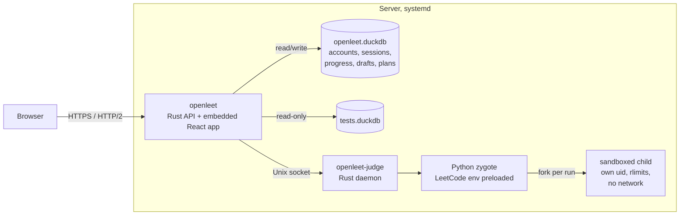
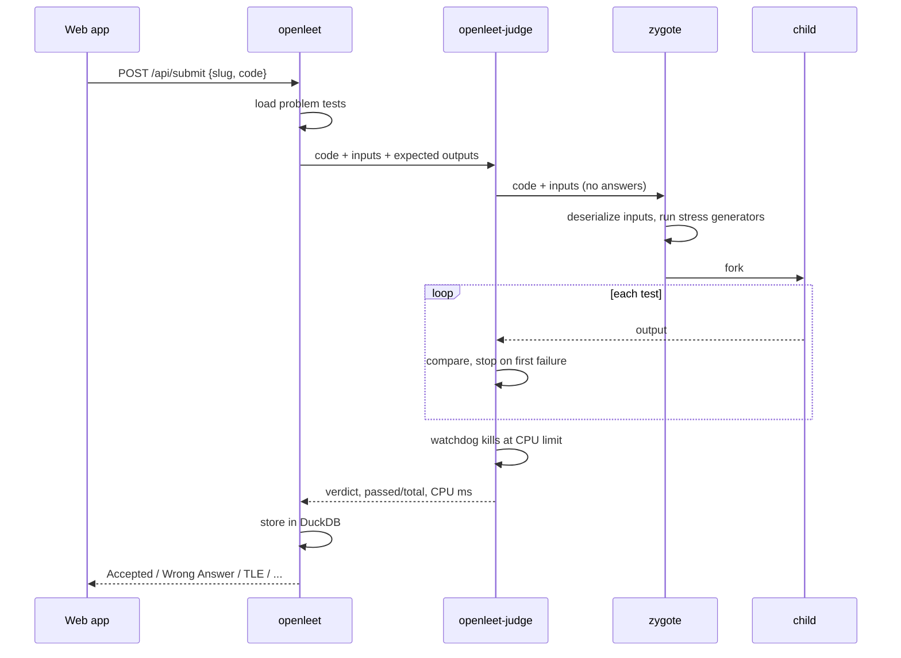
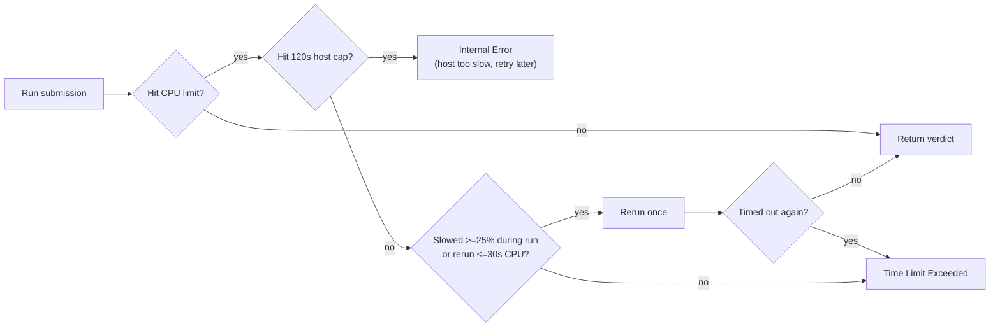
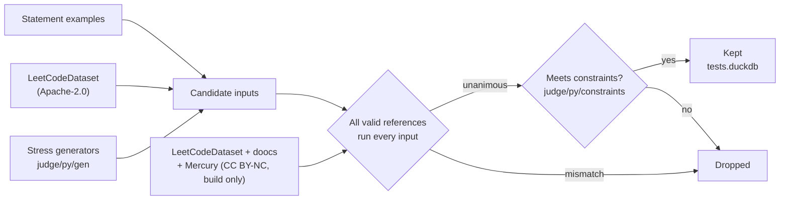

# Architecture

OpenLeet consists of three components: a Rust web/API server, a sandboxed judge daemon, and DuckDB
for storage.



## Server & caching

- **In-memory state**: Attempt logs, card states, notes, submission verdicts
  (`server/src/coding.rs`), practice plans, and custom lists are held in memory for up to 64
  recently active accounts (`server/src/state.rs`), with all mutations written through to DuckDB.
  Inactive accounts are evicted and reloaded on their next request. Next-problem selection and
  progress analytics (`server/src/insights.rs`) are computed from memory per request.
- **Readiness cache**: Readiness scores and daily trends (`server/src/readiness.rs`) are replayed
  from attempt and submission logs and cached per company until the logs change or 15 minutes pass.
- **Single-round-trip page loads**: `web/index.html` inlines the stylesheet and static shell. The
  server injects preload headers for the route's JS bundle and initial API calls
  (`server/src/preload.rs`) so assets and data download in parallel.

## Accounts and sessions

Authentication (`server/src/auth.rs`) uses email and password credentials and follows OWASP
authentication, session management, and password storage guidelines.

| Layer | Implementation |
| --- | --- |
| Password hashing | Argon2id (19 MiB, 2 iterations, 1 lane) with random salt; only the PHC string is stored. Bounded to 2 concurrent hashes and 16 queued requests to prevent memory/slot exhaustion. Unknown emails run the same hash and return the same `401` as wrong passwords. |
| Sessions | 256-bit random token in an `HttpOnly`, `SameSite=Lax` cookie (`Secure` + `__Host-` prefix over HTTPS). The `sessions` table stores only `SHA-256(token)`. Expires after 30 days of inactivity (sliding window refreshed on `GET /api/session`), on sign-out, on the browser's next sign-in, or on password change from another session. Max 20 active sessions per account. |
| Tenant isolation | Every progress handler requires the `auth::Me` extractor derived from the session cookie. All progress tables are scoped by `user_id`; accessing another account's plan, list, or submission ID returns `404`. Authenticated responses set `Cache-Control: private` and `Vary: Cookie`. |
| CSRF protection | Mutating endpoints reject requests with a mismatched `Origin` or `Sec-Fetch-Site` of `cross-site`/`same-site`, and require `application/json` bodies. |
| Rate limiting | Tracked per IPv4 address or IPv6 `/56` for sign-in/sign-up, per `(account, address)` for wrong passwords (preventing remote account lockout), and per authenticated account for password changes and deletion (see [API](api.md#accounts)). |
| Account deletion | Blocks new sessions and writes, waits for in-flight writes, then deletes all rows for that `user_id` in a single transaction. |
| Initial admin | On a fresh instance without an admin, the server writes a one-time setup code to `STATE_DIR/setup-code`. The first registration presenting that code becomes user `1` (admin) and inherits any pre-existing progress. Other sign-ups are rejected until setup completes (see [Deployment](deployment.md#initial-admin-setup)). |
| Navigation | Unauthenticated requests to progress pages redirect to `/login`; private data is only preloaded for signed-in browsers, and post-login redirects are restricted to same-origin paths. |

## Judging a submission



The judge executes one submission at a time for consistent CPU timing. The Python zygote
(`judge/py`) imports the LeetCode environment once and forks a child per submission. Each child
runs under its own UID and process group with no network, no filesystem writes, and no child
processes. Expected outputs never leave the Rust daemon.

Each submission is limited to a 704 MB address space. During corpus generation, any test that
causes a trusted reference solution to OOM is dropped (both during voting and during sequential
timing), so every problem's time limit is derived from references that pass all kept tests.

### Time limits

Time limits evaluate algorithmic complexity rather than host CPU speed. Before and after each run,
the zygote times a calibration workload (`judge/py/calibrate.py`) against a reference baseline to
compute a `slowdown` factor:

- **Host CPU budget**: `problem_limit * slowdown` (capped at 120 s of host CPU).
- **Reported CPU time**: `actual_cpu_ms / slowdown` (reference milliseconds).
- **On `e2-micro`**: `slowdown` is ~2.5 at rest and ~19 after CPU burst credits are exhausted (7x
  slower CPU time with no steal time; calibration tracks this within 15%).



Per-problem limits are computed from trusted reference solutions (`LeetCodeDataset` and `doocs`)
timed on the exact test suite (`src/openleet/judging/limits.py`):

| Rule | Value |
| --- | --- |
| Baseline | `50x` fastest trusted reference (capped at 10 s for this term) |
| Slowest-reference floor | At least `2x` slowest included reference |
| Bounds | Clamped to `1 s` .. `30 s` |
| Outlier exclusion | Trusted references >`10x` slower than the median still vote on outputs, but do not set limits |
| Mercury submissions | Vote on outputs only (often include suboptimal complexities that LeetCode accepts) |

The `50x` multiplier accommodates unoptimized implementations of the intended complexity (such as
memoized recursion or manual search over a sorted container), which measure up to `41x` the fastest
reference. A worse complexity class does roughly `n / log n` more work (`180x+` at `n >= 2,000`,
and thousands of times more at `10^4` to `10^5`).

```bash
uv run openleet judge time     # time all references on JUDGE_SOCKETS and compute limits
uv run openleet judge limits   # recompute limits from cached timings
```

## Where the tests come from



1. **Reference qualification**: A reference only participates if it reproduces every example output
   from the problem statement.
2. **Consensus voting**: A test is kept only if every qualifying reference produces the exact same
   output.
3. **Constraint screening**: Unanimous references can still accept out-of-spec inputs. Each problem
   defines a `check` function in `judge/py/constraints/<slug>.py` verifying sizes, value ranges,
   character sets, and structural invariants (e.g., valid tree, single duplicate). `judge screen`
   drops any test rejected by `check` and aborts if `check` rejects a statement example.
   `tests/test_screen.py` enforces this in CI.

### Output comparison & storage

- **Unordered checkers**: `unordered` sorts the outer list in structural JSON order (numbers sorted
  numerically); `unordered_nested` also sorts inner lists. For floating-point outputs, `1e-5`
  tolerance is applied after sorting. Both the corpus builder and the Rust judge use identical
  ordering.
- **Storage format**: `tests.duckdb` stores Zstandard-compressed test cases and JSON answers in
  `(slug, idx)` order with unique, consecutive indexes per problem. Large exact stress outputs are
  stored as digests.

```bash
uv run openleet judge check SLUG  # inspect tests rejected by a problem's constraints
uv run openleet judge screen      # drop rejected tests from data/judge/tests.duckdb
uv run openleet judge all         # rebuild data/judge/tests.duckdb
uv run openleet judge publish     # upload corpus release and pin sha256 in corpus.json
```
