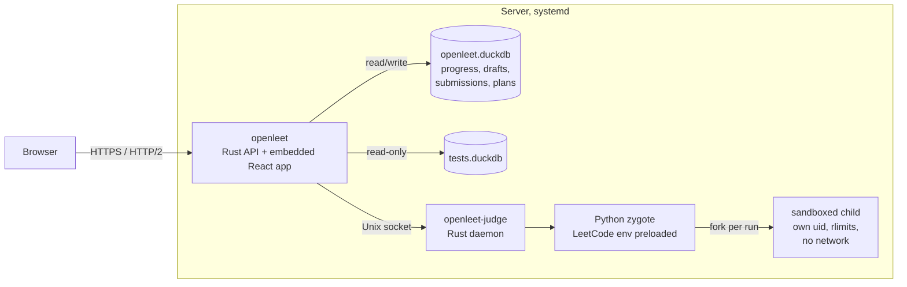
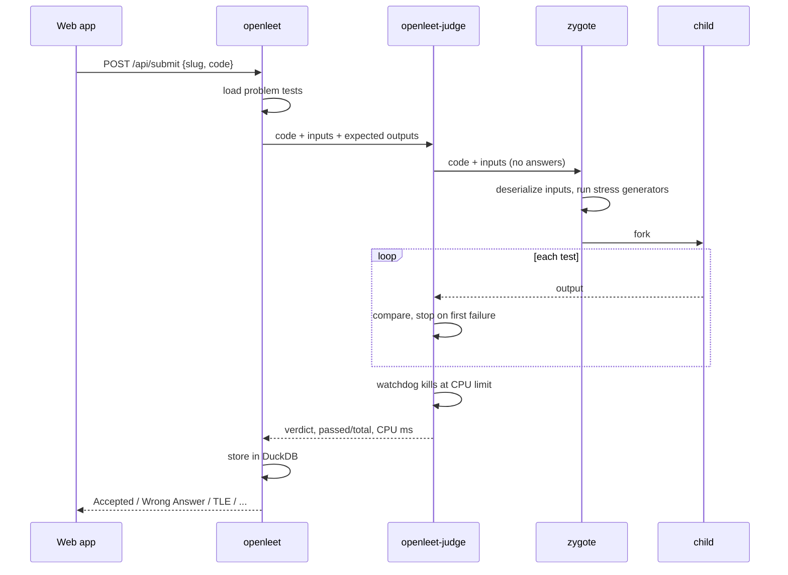
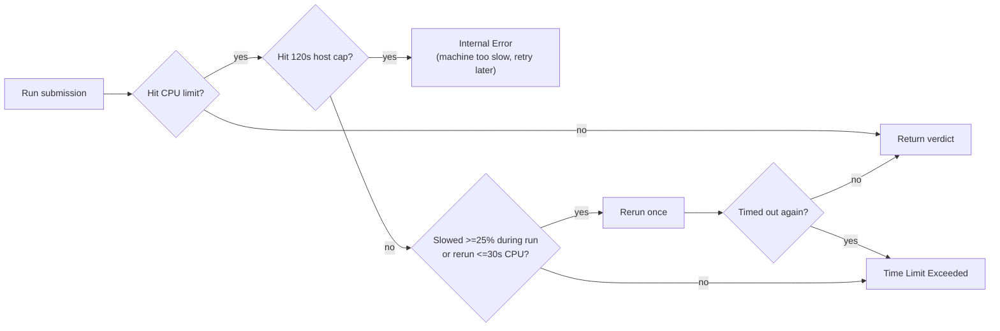
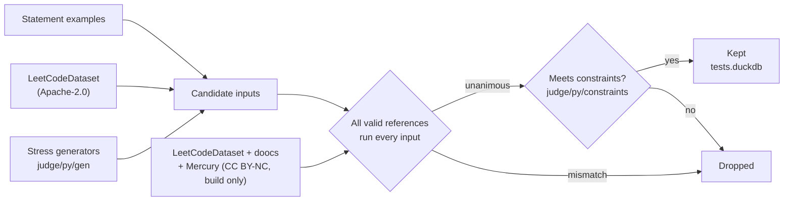

# Architecture

OpenLeet has three parts: a Rust web/API server, a sandboxed judge daemon, and DuckDB for storage.



## Server & caching

- **In-memory state**: Each active account's attempt log, card states, notes, submission verdicts
  (`server/src/coding.rs`), practice plans, and lists live in memory and write through to DuckDB.
  The server keeps the 64 most recently used accounts in memory and loads others on their next
  request (`server/src/state.rs`). Next
  problem selection and progress analytics (`server/src/insights.rs`) are computed directly from
  memory on each request.
- **Readiness cache**: Readiness scores and daily trends (`server/src/readiness.rs`) are replayed
  from attempt and submission logs and cached per company until the logs change or 15 minutes pass.
- **Single-round-trip loads**: `web/index.html` inlines the stylesheet and static shell. The server
  injects preload headers for the route's JS bundle and initial API calls
  (`server/src/preload.rs`) so code and data download in parallel.

## Accounts and sessions

Each person signs in with an email and a password (`server/src/auth.rs`). The design follows the
OWASP authentication, session, and password storage cheat sheets.

- **Passwords**: Argon2id with a random salt and OWASP's parameters (19 MiB, 2 passes, 1 lane).
  The database stores only the PHC string. At most 2 hashes run at once and at most 16 requests
  wait for one, so many sign-ins cannot use up the server's memory or its request slots. An
  unknown email costs the same hash as a wrong password, and both get the same answer.
- **Sessions**: A random 256-bit token in a cookie with `HttpOnly`, `SameSite=Lax`, and, over
  HTTPS, `Secure` and the `__Host-` prefix. The `sessions` table stores only the token's SHA-256,
  so the database and its backups cannot sign anyone in. A session ends after 30 days without
  use, at sign-out, at the browser's next sign-in, or when the account's password changes in
  another session. An account keeps at most 20 sessions. A session moves on only at
  `GET /api/session`, whose answer is private.
- **Isolation**: A handler reaches progress only through `auth::Me`, which the server makes from
  the session. Every progress table has a `user_id` column, and every query filters on it. A
  plan, list, or submission id of another account answers `404`, the same as an unknown id. API
  answers carry `Cache-Control: private` and `Vary: Cookie`.
- **Cross-site requests**: The API refuses writes whose `Origin` is another host or whose
  `Sec-Fetch-Site` is `cross-site` or `same-site`. Bodies must be JSON, which a plain HTML form
  cannot send.
- **Limits**: Sign-in and sign-up count attempts per IPv4 address or IPv6 /56. Wrong passwords
  count per account and address, so nobody can lock an account out from elsewhere, and per
  signed-in account for password changes and deletion (see [API](api.md#accounts)).
- **Deletion**: Deleting an account removes its rows from every table in one transaction. The
  server first refuses new sessions and writes for it, and waits for writes in flight.
- **First admin**: A server without an admin writes a one-time setup code to
  `STATE_DIR/setup-code`. The sign-up that gives it becomes user 1, the admin, and owns the
  progress from before accounts. Until then no other sign-up works. See
  [Deployment](deployment.md#make-the-admin-account).
- **Pages**: Pages that show progress redirect a signed-out browser to `/login`. The server
  preloads a page's private data only for a signed-in browser. After sign-in the app goes back
  only to a page of the same origin.

## Judging a submission



The judge runs one submission at a time for consistent CPU measurements. The Python zygote
(`judge/py`) imports the LeetCode environment once and forks a child per submission. Each child
runs under its own UID and process group, with no network, no file writes, and no child processes.
Expected outputs never leave the Rust daemon.

Each submission gets a 704 MB address space. During corpus building, any test that causes a
trusted reference solution to OOM is dropped (both during voting and during sequential timing), so
every problem's time limit comes from references that pass all kept tests.

### Time limits

Time limits measure algorithmic complexity rather than raw CPU speed. Before and after each run,
the zygote times a small calibration workload (`judge/py/calibrate.py`) and compares it to the
reference machine to compute a `slowdown` factor.

- **Budget**: `machine_limit = problem_limit * slowdown` (capped at 120 s of host CPU).
- **Reported time**: `actual_cpu_ms / slowdown` (reference milliseconds).
- **On `e2-micro`**: `slowdown` is ~2.5 at rest and ~19 after CPU burst credits run out (7x slower
  CPU time with no steal time; calibration tracks this within 15%).



Limits are set from trusted reference solutions (`LeetCodeDataset` and `doocs`) timed on the exact
test suite (`src/openleet/judging/limits.py`):

| Rule | Value |
| --- | --- |
| Baseline | `50x` fastest trusted reference (capped at 10 s for this term) |
| Slowest-reference floor | At least `2x` slowest included reference |
| Bounds | Clamped to `1 s` .. `30 s` |
| Outlier exclusion | Trusted references >`10x` slower than the median still vote on outputs, but don't set limits |
| Mercury submissions | Vote on outputs only (often include suboptimal complexities that LeetCode accepts) |

Why `50x`? A clumsy implementation of the same complexity (memoized recursion, manual search over a
sorted container) can take up to `41x` the fastest reference. A worse complexity class does roughly
`n / log n` more work (`180x+` at `n >= 2,000`, and thousands of times more at `10^4` to `10^5`).

```bash
uv run openleet judge time     # time all references on JUDGE_SOCKETS and compute limits
uv run openleet judge limits   # recompute limits from cached timings
```

## Where the tests come from



1. **Reference qualification**: A reference only counts if it reproduces every example output from
   the problem statement.
2. **Voting**: A test is kept only if every qualifying reference produces the exact same answer.
3. **Constraint screening**: Even unanimous references can accept out-of-spec inputs. Each problem
   has a `check` function in `judge/py/constraints/<slug>.py` verifying sizes, value ranges,
   character sets, and structural invariants (e.g., valid tree, single duplicate). `judge screen`
   drops any test rejected by `check` and refuses to run if `check` rejects a statement example.
   `tests/test_screen.py` enforces this in CI.

### Output comparison & storage

- **Unordered checkers**: `unordered` sorts the outer list in structural JSON order (numbers sorted
  numerically); `unordered_nested` also sorts inner lists. For float outputs, `1e-5` tolerance is
  applied after sorting. Both the corpus builder and the Rust judge use identical ordering.
- **Storage format**: `tests.duckdb` stores Zstandard-compressed test cases and JSON answers in
  `(slug, idx)` order with unique, consecutive indexes per problem. Large exact stress outputs are
  stored as digests.

```bash
uv run openleet judge check SLUG  # inspect tests rejected by a problem's constraints
uv run openleet judge screen      # drop rejected tests from data/judge/tests.duckdb
uv run openleet judge all         # rebuild data/judge/tests.duckdb
uv run openleet judge publish     # upload corpus release and pin sha256 in corpus.json
```
