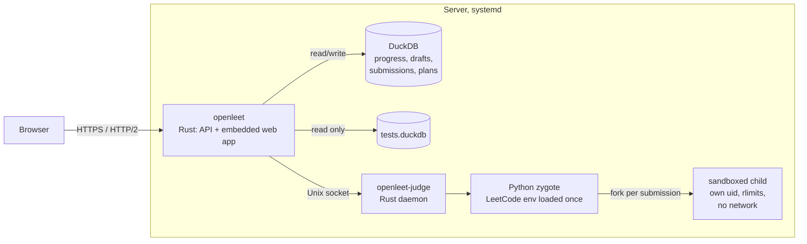
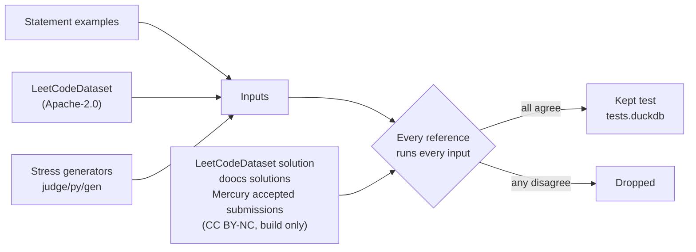

# Architecture

OpenLeet has three parts: a Rust server for the web app and the JSON API, a judge daemon that
runs submissions, and a DuckDB database file.



The server keeps the attempt log, card states, notes, a log of every submission's verdict
(`server/src/coding.rs`) and the practice plans in memory and writes every change through to
DuckDB. A plan's next problem and the progress page's analytics (`server/src/insights.rs`) are
computed from memory on each request.

A page loads in one round trip. `web/index.html` inlines the stylesheet and a static shell, and the
server adds preload links for the route's code and its first API calls (`server/src/preload.rs`),
so code and data download together.

## Judging a submission


The judge runs one submission at a time, so CPU times are comparable. The zygote (`judge/py`)
imports the LeetCode environment once and forks a child per submission. The child gets its own
user and process group, cannot write files or start processes, and has no network. Expected
outputs stay in the Rust daemon.

A solution gets about 370 MB of heap before Memory Limit Exceeded.

### Time limits

A time limit tests the solution's complexity, not the machine. Times are kept in reference
milliseconds: right before each run, and again after it, the zygote times a fixed piece of
typical solution work (`judge/py/calibrate.py`). How much longer that takes than on the reference
machine is the machine's slowdown. The watchdog allows the limit times the slowdown, and CPU
times are reported divided by it. On the e2-micro the slowdown is about 2.5 at rest and about 19
once its burst allowance runs out, when CPU time per unit of work grows sevenfold without any
steal time to show for it; the calibration slows by the same factor, to within 15 %. A run that
hits the limit runs once more when the machine slowed down by 25 % or more during it, or when
another run costs at most 30 s of CPU, so a Time Limit Exceeded stands only when two runs agree.
No run may use more than 120 s of the machine's CPU; when a slow machine cannot give a problem
its full limit within that, the submission is not judged and the page asks for it again later.

Each problem's limit comes from its trusted reference solutions (LeetCodeDataset's and
doocs'), timed through the judge on exactly the tests a submission gets: 50× the fastest (but
no more than 10 s for that), at least 2× the slowest and at least 1 s, at most 30 s
(`src/openleet/judging/limits.py`). Mercury's accepted submissions vote on the expected outputs
but set no limits: the slowest of them are often a worse complexity class that LeetCode accepts.
The same complexity written clumsily (memoized recursion, a sorted container searched by hand)
takes up to 41× the fastest reference, while the next complexity class does about n / log n
times the work: 180× or more on stress inputs of 2,000 elements and up, and thousands of times
on the usual 10^4 to 10^5. Problems whose tests are small cannot tell the classes apart.

```bash
uv run openleet judge time     # time every reference on the judges in JUDGE_SOCKETS, set limits
uv run openleet judge limits   # set limits again from the cached times
```

## Where the tests come from



A reference solution counts only if it reproduces the statement's example outputs. A test is kept
only when every counted reference gives the same answer.

```bash
uv run openleet judge all       # rebuild data/judge/tests.duckdb
uv run openleet judge publish   # upload it to the corpus release and pin it in corpus.json
```
