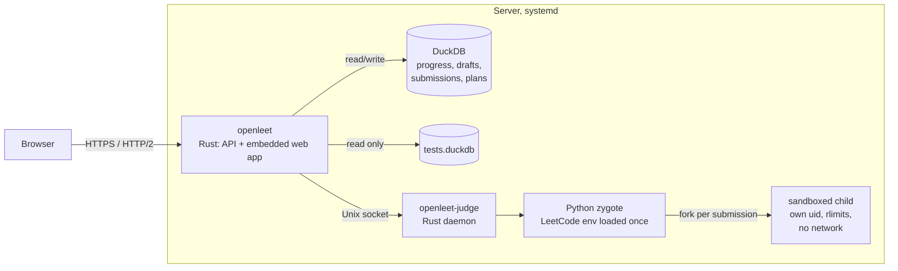
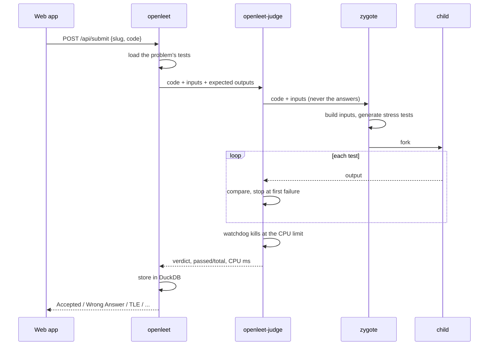
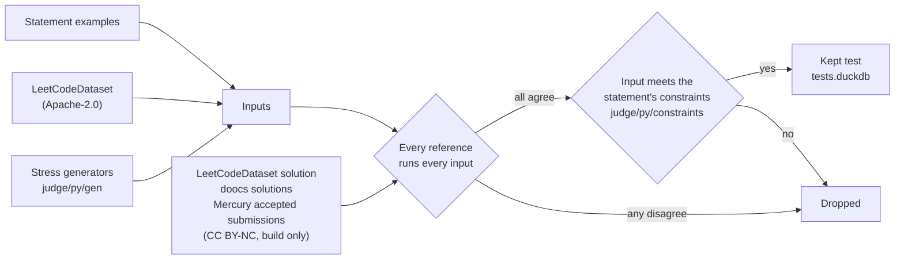

# Architecture

OpenLeet has three parts: a Rust server for the web app and the JSON API, a judge daemon that
runs submissions, and a DuckDB database file.



The server keeps the attempt log, card states, notes, a log of the verdict of every submission
(`server/src/coding.rs`) and the practice plans in memory. It writes every change through to
DuckDB. The server computes the next problem of a plan and the analytics of the progress page
(`server/src/insights.rs`) from memory on each request.

The server replays readiness and its daily trend (`server/src/readiness.rs`) from the attempt and
submission logs. It caches the result per company until the logs change or 15 minutes pass.

A page loads in one round trip. `web/index.html` inlines the stylesheet and a static shell. The
server adds preload links for the code of the route and its first API calls
(`server/src/preload.rs`), so the code and the data download together.

## Judging a submission



The judge runs one submission at a time, so CPU times are comparable. The zygote (`judge/py`)
imports the LeetCode environment once and forks a child for each submission. The child gets its
own user and process group, cannot write files or start processes, and has no network. Expected
outputs stay in the Rust daemon.

Each solution runs in a 704 MB address space. During corpus voting, a test stays only when the
required reference solutions finish it within that limit. A memory failure of a reference drops
that test, while voting continues on later tests. Timing runs the references again through the
judge, one test after another in the same process. If a trusted reference cannot finish a test in
memory there, the test is dropped for every reference and the timing starts again. Thus every
limit comes from references that finish every kept test.

### Time limits

A time limit tests the complexity of the solution, not the machine. The judge keeps times in
reference milliseconds. Right before each run, and again after it, the zygote times a fixed piece
of typical solution work (`judge/py/calibrate.py`). How much longer that work takes than on the
reference machine is the slowdown of the machine. The watchdog allows the limit times the
slowdown, and the judge reports CPU times divided by the slowdown.

On the e2-micro the slowdown is about 2.5 at rest and about 19 once its burst allowance runs out.
Then CPU time per unit of work grows sevenfold without any steal time to show for it. The
calibration slows by the same factor, to within 15 %.

A run that hits the limit runs once more when the machine slowed down by 25 % or more during it,
or when another run costs at most 30 s of CPU. Thus a Time Limit Exceeded stands only when two
runs agree. No run may use more than 120 s of the CPU of the machine. When a slow machine cannot
give a problem its full limit within that budget, the judge does not judge the submission and the
page asks for the submission again later.

The trusted reference solutions of a problem (LeetCodeDataset's and doocs') set its limit. The
judge times them on exactly the tests that a submission gets. The limit is 50× the fastest
reference (but no more than 10 s for that), at least 2× the slowest included reference, at least
1 s and at most 30 s (`src/openleet/judging/limits.py`). A trusted reference more than 10× slower
than the median of the other trusted references of the problem does not set the limit, but it
still votes on answers. The accepted submissions of Mercury vote on the expected outputs but set
no limits: the slowest of them are often a worse complexity class that LeetCode accepts.

The same complexity, written clumsily (memoized recursion, a sorted container that the code
searches by hand), takes up to 41× the fastest reference. The next complexity class does about
n / log n times the work: 180× or more on stress inputs of 2,000 elements and up, and thousands
of times on the usual 10^4 to 10^5. Problems with small tests cannot tell the classes apart.

```bash
uv run openleet judge time     # time every reference on the judges in JUDGE_SOCKETS, set limits
uv run openleet judge limits   # set limits again from the cached times
```

## Where the tests come from



A reference solution counts only if it reproduces the example outputs of the statement. A test
stays only when every counted reference gives the same answer and its input meets every
constraint that the statement states. References can agree on an input that the problem never
allows. Thus each problem has `judge/py/constraints/<slug>.py`: a `check` function that takes the
input of a test and asserts each size, range, character set and guarantee ("exactly one value is
repeated", "the input is a valid tree").

`judge screen` drops the tests that a check rejects. It refuses to run when a check rejects one
of the examples of the statement. `tests/test_screen.py` fails if the corpus holds a test that
the check of its problem rejects.

The `unordered` checker sorts the outer list by structural JSON order, with numbers sorted
numerically. `unordered_nested` also sorts each inner list. When a problem returns floats, the
judge applies the 1e-5 tolerance after sorting. The assembler and the Rust judge use the same
ordering.

The corpus stores test cases and JSON answers with Zstandard compression, in `(slug, idx)` order.
For large exact stress answers, it stores a digest instead. The writer checks that the indexes of
each problem are unique and consecutive.

```bash
uv run openleet judge check SLUG  # the tests a problem's constraints reject
uv run openleet judge screen      # drop them from data/judge/tests.duckdb
uv run openleet judge all       # rebuild data/judge/tests.duckdb
uv run openleet judge publish   # upload it to the corpus release and pin it in corpus.json
```
