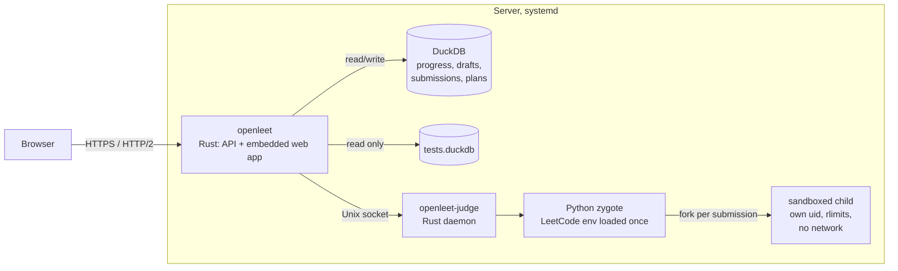
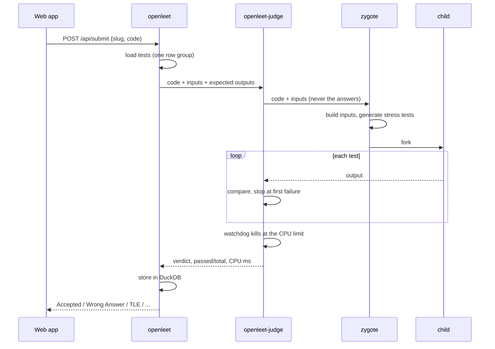
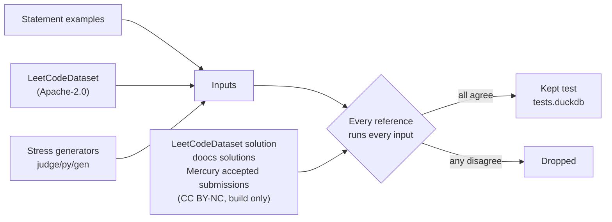

# Architecture

OpenLeet is one Rust server that serves the web app and a JSON API, a judge daemon that runs
submissions, and a DuckDB database file.



The server keeps the attempt log, card states, notes, the solved and tried problems and the
practice plans in memory and writes every change through to DuckDB. A plan's next problem is
computed from memory on each request (`server/src/plan.rs`).

A page loads in one round trip. `web/index.html` inlines the stylesheet and a static shell, and the
server adds preload links for the route's code and its first API calls (`server/src/preload.rs`),
so code and data download together.

## Judging a submission



The judge runs one submission at a time, so CPU times are comparable. The zygote (`judge/py`)
imports the LeetCode environment once and forks a child per submission. The child gets its own
user and process group, cannot write files or start processes, and has no network. Expected
outputs stay in the Rust daemon.

The time limit is the larger of 4× the fastest reference solution and 1.25× the slowest, times
`JUDGE_CPU_SCALE`, plus 500 ms, kept between 2 and 30 s. A solution gets about 370 MB of heap
before Memory Limit Exceeded.

## Where the tests come from



A reference solution counts only if it reproduces the statement's example outputs. A test is kept
only when every counted reference gives the same answer.

```bash
uv run openleet judge all       # rebuild data/judge/tests.duckdb
uv run openleet judge publish   # upload it to the corpus release and pin it in corpus.json
```
