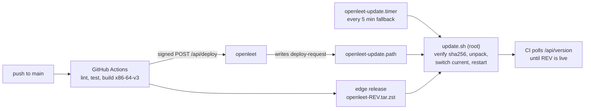
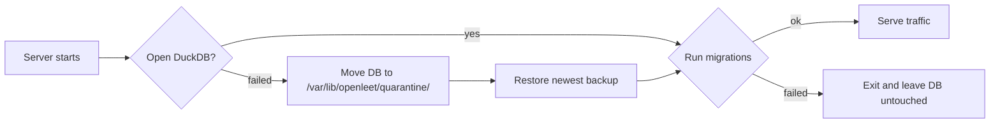

# Deployment



Every push to `main` builds a release archive in GitHub Actions and sends a signed deploy request
to the server. The server writes a trigger file; `update.sh` (running as root) downloads and
verifies the archive, atomically switches `/opt/openleet/current`, and restarts the services.

## On the server

Everything runs as enabled systemd units, so reboots require no manual intervention:

| Unit | Role |
| --- | --- |
| `openleet-http.socket`, `openleet-https.socket` | Hold ports 80 and 443 across restarts (zero dropped connections) |
| `openleet.service` | Rust server; watchdog-monitored, renews Let's Encrypt cert 30 days before expiry, takes daily DB backups (14 kept in `/var/lib/openleet/backups/`) |
| `openleet-judge.service` | Sandboxed judge daemon |
| `openleet-health.timer` | Restarts `openleet` after 3 failed health checks and restarts `openleet-judge` if down |
| `openleet-update.path`, `openleet-update.timer` | Runs `update.sh` on deploy requests and every 5 minutes as a fallback |

### Database startup & recovery



## New server

Requirements: Ubuntu 24.04 with at least 1 GB RAM (a free GCP `e2-micro` works), ports 80 and 443
open, and a DNS `A` record pointing to the VM.

```bash
git clone https://github.com/nsudhanva/openleet && cd openleet
sudo SITE_ADDRESS=openleet.example.com deploy/install.sh
```

The installer takes ~2 minutes and sets up:

- The `openleet` system user and Python runtime for the judge
- 1 GB swap file (if none exists) and automatic security-update reboots at 10:00
- `/etc/openleet.env`, systemd units, and the latest release (server, web UI, data, test corpus)

Let's Encrypt issues the TLS certificate within a minute. Verify with:

```bash
curl https://openleet.example.com/api/health
```

Optional environment variables (re-run `install.sh` to update them; omitted values are preserved):

- `TZ`: timezone for streak day boundaries (e.g., `America/Los_Angeles`, default `UTC`)
- `DEPLOY_SECRET`: shared HMAC secret for instant deploys from CI
- `SITE_ADDRESS=http://HOST`: plain HTTP without TLS

New releases are installed automatically within 5 minutes. To migrate progress from another
server, restore its backup below.

## Make the admin account

A server without an admin writes a one-time setup code to `/var/lib/openleet/setup-code` (mode
`0600`) and logs where it is. Until the admin account exists, nobody can sign up.

1. Read the code on the server:

   ```bash
   sudo cat /var/lib/openleet/setup-code
   ```

2. Open the site, choose **Create account**, and enter your email, a password, and the code.

The account becomes user 1 and the admin. It owns all progress from before accounts existed.
The server deletes the file and the code stops working. The admin can open or close sign-ups on
the **Account** page. Each restart without an admin writes a new code.

## Restore a backup

`/var/lib/openleet/backups/` stores the last 14 daily backups (`DATE.duckdb`) and the last 3
pre-migration snapshots (`pre-migration-STAMP.duckdb`). Restoring discards changes made after the
backup was taken:

```bash
sudo systemctl stop openleet
sudo sh -c 'cd /var/lib/openleet && mkdir -p replaced && mv openleet.duckdb* replaced/'
sudo install -o openleet -g openleet -m 0600 BACKUP.duckdb /var/lib/openleet/openleet.duckdb
sudo systemctl start openleet
```

If the backup uses an older schema, the server migrates it automatically on start.

## Roll back

`update.sh` keeps the 3 newest releases in `/opt/openleet/releases/`. To switch back to an older
revision:

```bash
old=/opt/openleet/releases/REV
sudo "$old/deploy/install.sh" --units-only
sudo ln -sfn "$old" /opt/openleet/current
sudo systemctl restart openleet-judge openleet
```

`update.sh` records every deployed revision and never reinstalls an older one, so neither CI nor
the 5-minute timer will undo a rollback. The next push to `main` resumes normal deploys.

> **Schema downgrades:** A binary refuses to open a database migrated by a newer release (logged
> as `"newer than this build's"` in `journalctl -u openleet`). To roll back across a migration,
> also restore the corresponding `pre-migration-*.duckdb` or older daily backup.

## Deploy from your own fork

The installer reads `OPENLEET_REPO` from the clone's `origin` remote and saves it to
`/etc/openleet.env`, so clone your fork on the server. Then in your fork's GitHub settings:

1. **Enable GitHub Actions**: every push to `main` publishes an `edge` release that your server
   picks up within 5 minutes.
2. **Instant deploys (optional)**: add repository variable `SITE_URL`
   (`https://openleet.example.com`) and secret `DEPLOY_SECRET` (e.g., `openssl rand -hex 32`),
   then pass the same secret on the server: `sudo DEPLOY_SECRET=... deploy/install.sh`.

The test corpus isn't committed to git; `data/judge/corpus.json` points to the upstream release
asset until you rebuild and publish your own (`uv run openleet judge publish`). The `images`
workflow publishes Docker images to `ghcr.io/OWNER` (run with
`IMAGES=ghcr.io/OWNER docker compose up -d`).
