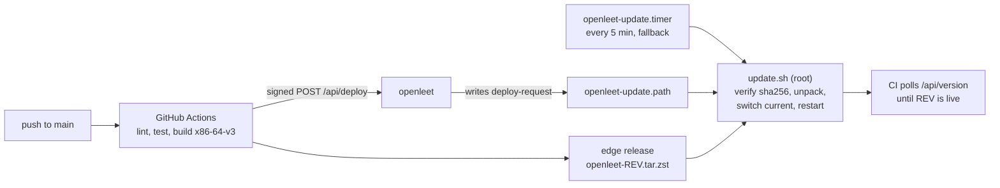

# Deployment



A push to `main` runs the checks, builds a release archive and asks the server to deploy it. The
server only records the request; `update.sh` runs as root, verifies the archive, switches
`/opt/openleet/current` to it and restarts the services.

## On the server

Every part is a systemd unit enabled at boot, so a reboot needs no manual step.

- `openleet-http.socket` and `openleet-https.socket` hold ports 80 and 443, so a restart drops no
  connections.
- systemd restarts the server if it exits or stops answering its watchdog.
  `openleet-health.timer` restarts the server after three failed health checks and the judge
  when it is down.
- The server renews its TLS certificate 30 days before it expires.
- The database is copied to `/var/lib/openleet/backups/` every day, and the last 14 copies are
  kept.

On start the server runs any pending migrations. If the database file cannot be opened, it is
moved to `/var/lib/openleet/quarantine/` and the newest backup is restored. If the file opens but a
migration fails, the server stops and leaves the file as it is.

## Restore a backup

`/var/lib/openleet/backups/` holds a copy of the database for each of the last 14 days
(`DATE.duckdb`) and for each of the last three migrations, taken right before it ran
(`pre-migration-STAMP.duckdb`). Restoring one loses every change made after it was taken. Stop
the server, move the database aside and put the backup in its place:

```bash
sudo systemctl stop openleet
sudo sh -c 'cd /var/lib/openleet && mkdir -p replaced && mv openleet.duckdb* replaced/'
sudo install -o openleet -g openleet -m 0600 BACKUP.duckdb /var/lib/openleet/openleet.duckdb
sudo systemctl start openleet
```

The server migrates a backup with an older schema when it starts.

## Roll back

`update.sh` keeps the newest three releases in `/opt/openleet/releases/`. To run an older one,
install its units and scripts, point `current` at it and restart:

```bash
old=/opt/openleet/releases/REV
sudo "$old/deploy/install.sh" --units-only
sudo ln -sfn "$old" /opt/openleet/current
sudo systemctl restart openleet-judge openleet
```

`update.sh` never installs a revision it has installed before, so neither CI's deploy request
nor the 5-minute timer undoes the rollback; the next push to `main` does.

A build cannot open a database that a newer release has migrated: the server stops with "newer
than this build's" in its log (`journalctl -u openleet`). To roll back past a migration, also
restore the copy taken right before that migration, or the newest daily backup older than it (see
above).

## New server

You need an Ubuntu 24.04 machine with 1 GB of memory or more (a free e2-micro on Google Cloud
works), ports 80 and 443 open to the internet, and a DNS A record pointing a domain at it.

```bash
git clone https://github.com/nsudhanva/openleet && cd openleet
sudo SITE_ADDRESS=openleet.example.com deploy/install.sh
```

The installer takes about two minutes. It creates the `openleet` user, installs Python for the
judge, adds 1 GB of swap when the machine has none, lets security updates reboot the machine at
10:00, writes `/etc/openleet.env`, then downloads the newest release (server, web app, problems
and test corpus) and starts it. The server gets its TLS certificate from Let's Encrypt within a minute;
check it with `curl https://openleet.example.com/api/health`.

The installer also takes `TZ` (the day boundary for streaks, such as `America/Los_Angeles`; UTC
by default) and `DEPLOY_SECRET` (see below). Run it again to change them; it keeps the values
you leave out. `SITE_ADDRESS=http://HOST` serves plain HTTP without a certificate.

The server installs each new release within 5 minutes. To bring progress over from another
server, restore a backup of it (see above).

## Deploy from your own fork

A server installs releases from the GitHub repository it was cloned from (`OPENLEET_REPO` in
`/etc/openleet.env`), so clone your fork on the server. Then, in the fork's settings:

1. Enable GitHub Actions. Each push to `main` publishes a release; your server picks it up within
   5 minutes.
2. For deploys within seconds of a push, add the repository variable `SITE_URL`
   (`https://openleet.example.com`) and the secret `DEPLOY_SECRET` (any long random string,
   such as the output of `openssl rand -hex 32`), and give the server the same secret:
   `sudo DEPLOY_SECRET=... deploy/install.sh`.

The test corpus is not in git: `data/judge/corpus.json` names the repository and release asset
that hold it, so a fork uses its upstream's corpus until it rebuilds and publishes its own
(`uv run openleet judge publish`). The fork's `images` workflow publishes Docker images to
`ghcr.io/OWNER`; run them with `IMAGES=ghcr.io/OWNER docker compose up -d`.
