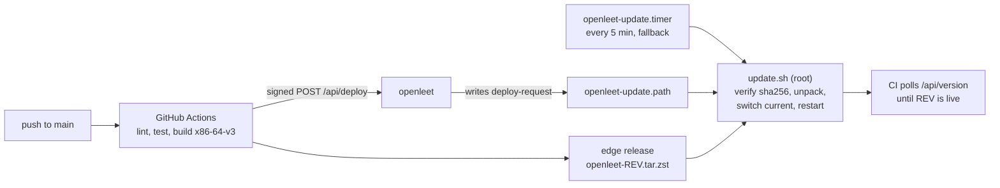

# Deployment

A push to `main` runs the checks, builds a release archive and asks the server to deploy it. The
server only records the request; `update.sh` runs as root, verifies the archive, switches
`/opt/openleet/current` to it and restarts the services.

## On the server

Every part is a systemd unit enabled at boot, so a reboot needs no manual step.

- `openleet-http.socket` and `openleet-https.socket` hold ports 80 and 443, so a restart drops no
  connections.
- systemd restarts the server if it exits or stops answering its watchdog.
  `openleet-health.timer` restarts the server after three failed health checks and the judge
  when it is down.
- The server renews its TLS certificate 30 days before it expires.
- The database is copied to `/var/lib/openleet/backups/` every day, and the last 14 copies are
  kept.

On start the server runs any pending migrations. If the database file cannot be opened, it is
moved to `/var/lib/openleet/quarantine/` and the newest backup is restored. If the file opens but a
migration fails, the server stops and leaves the file as it is.

## Roll back

Point `/opt/openleet/current` at an older directory in `/opt/openleet/releases/` and restart
`openleet-judge` and `openleet`.

## New server

Copy `deploy/` to an Ubuntu host, run `sudo deploy/install.sh`, fill in `/etc/openleet.env`
(`DEPLOY_SECRET` must match the GitHub secret), then run `sudo /opt/openleet/update.sh`.
