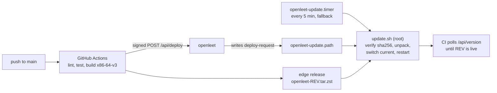

# Deployment



A push to `main` runs the checks, builds a release archive and asks the server to deploy it. The
server only records the request; `update.sh` runs as root, verifies the archive, switches
`/opt/openleet/current` to it and restarts the services.

## On the server

Every part is a systemd unit enabled at boot, so a reboot needs no manual step.

- `openleet-http.socket` and `openleet-https.socket` hold ports 80 and 443, so a restart drops no
  connections.
- systemd restarts the server if it exits or stops answering its watchdog.
  `openleet-health.timer` restarts the server after three failed health checks and the judge
  when it is down.
- The server renews its TLS certificate 30 days before it expires.
- The database is copied to `/var/lib/openleet/backups/` every day, and the last 14 copies are
  kept.

On start the server runs any pending migrations. If the database file cannot be opened, it is
moved to `/var/lib/openleet/quarantine/` and the newest backup is restored. If the file opens but a
migration fails, the server stops and leaves the file as it is.

## Restore a backup

`/var/lib/openleet/backups/` holds a copy of the database for each of the last 14 days
(`DATE.duckdb`) and for each of the last three migrations, taken right before it ran
(`pre-migration-STAMP.duckdb`). Restoring one loses every change made after it was taken. Stop
the server, move the database aside and put the backup in its place:

```bash
sudo systemctl stop openleet
sudo sh -c 'cd /var/lib/openleet && mkdir -p replaced && mv openleet.duckdb* replaced/'
sudo install -o openleet -g openleet -m 0600 BACKUP.duckdb /var/lib/openleet/openleet.duckdb
sudo systemctl start openleet
```

The server migrates a backup with an older schema when it starts.

## Roll back

`update.sh` keeps the newest three releases in `/opt/openleet/releases/`. To run an older one,
install its units and scripts, point `current` at it and restart:

```bash
old=/opt/openleet/releases/REV
sudo "$old/deploy/install.sh" --units-only
sudo ln -sfn "$old" /opt/openleet/current
sudo systemctl restart openleet-judge openleet
```

`update.sh` never installs a revision it has installed before, so neither CI's deploy request
nor the 5-minute timer undoes the rollback; the next push to `main` does.

A build cannot open a database that a newer release has migrated: the server stops with "newer
than this build's" in its log (`journalctl -u openleet`). To roll back past a migration, also
restore the copy taken right before that migration, or the newest daily backup older than it (see
above).

## New server

1. In Google Cloud, create an e2-micro VM with Ubuntu, a static external IP and the network tag
   `web-server`, which the firewall rule for ports 80 and 443 applies to. Point a DNS A record
   for every name in `SITE_ADDRESS` at that IP.
2. Copy `deploy/` to the VM and run `sudo deploy/install.sh`. It also adds 1 GB of swap when the
   machine has none, and lets security updates reboot the machine at 10:00.
3. Fill in `/etc/openleet.env` (`DEPLOY_SECRET` must match the GitHub secret), then run
   `sudo /opt/openleet/update.sh` and `sudo systemctl restart openleet`: the update timer may
   already have started the server with the file's placeholder values.
4. To bring progress over, restore a backup of the old server (see above).
