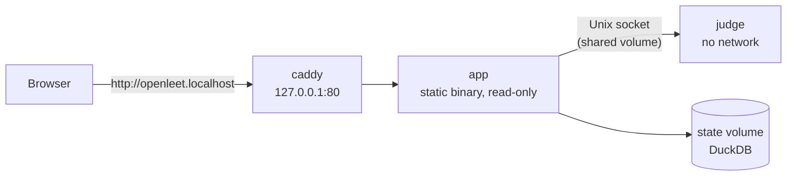

# Development

## Run the full stack



```bash
docker compose up -d           # prebuilt images from ghcr.io
docker compose up -d --build   # build both images from this checkout
```

## Run from source

Prerequisites: [uv](https://docs.astral.sh/uv/), [Bun](https://bun.sh), the Rust toolchain in
`rust-toolchain.toml`, and Docker. Because the judge requires Linux, macOS runs only the judge in
a container:

```bash
uv sync && uv run openleet judge fetch && bun install && bun run build
docker compose --profile dev up -d judge-dev   # judge on 127.0.0.1:7777
JUDGE_SOCKET=tcp://127.0.0.1:7777 cargo run --release -p openleet
```

The first `cargo run --release` compiles DuckDB and takes a few minutes. Once built:

- Server: <http://localhost:8080>
- Frontend hot reload: `bun run dev` serves <http://localhost:3000> and proxies `/api` to port
  8080 (set `API_URL=http://openleet.localhost bun run dev` to target the Compose stack instead).
- Local state: stored in `data/openleet.duckdb` with daily backups in `data/backups/` (both
  gitignored). Stop the server and delete them to reset.
- Stop the dev judge: `docker compose --profile dev down judge-dev`.

## Checks & smoke tests

CI runs the exact same checks as the pre-push hook. Install the hooks with `uv run prek install`,
or run everything manually:

```bash
uv run prek run --all-files --hook-stage pre-push
```

Run end-to-end judge tests (reference solutions, wrong/crashing code, time/memory limits, sandbox
escapes, and invalid requests) against a running server:

```bash
uv run openleet smoke --base-url http://localhost:8080 --allow-network
```

`openleet smoke` needs an account. With `OPENLEET_EMAIL` and `OPENLEET_PASSWORD` set, it signs in
as that account, restores any drafts it modifies, and leaves its submissions in that account's
history. Without them it makes a throwaway account (sign-ups must be open) and deletes it, with
everything it did, at the end.

The web end-to-end suite (`E2E_BASE_URL=http://localhost:8080 bun run test:e2e` in `web/`) also
runs as a throwaway account. On a new server without an admin, set `E2E_SETUP_CODE` to the
server's setup code; the suite's account then becomes the admin and stays.

## Repository layout

| Path | Contents |
| --- | --- |
| `server/` | Rust API and web server (embeds `web/dist`) |
| `judge/` | Rust judge daemon; `judge/py/` is the Python zygote, sandbox, generators, and constraints |
| `proto/` | Types shared between `server/` and `judge/` |
| `web/` | React app (Vite, TanStack Router, Tailwind) |
| `src/` | Python data and judge CLI (`openleet`) |
| `data/` | Problems, approaches, videos, and judge specs |
| `deploy/` | Systemd units and install/update scripts |
| `docs/` | Project documentation |
