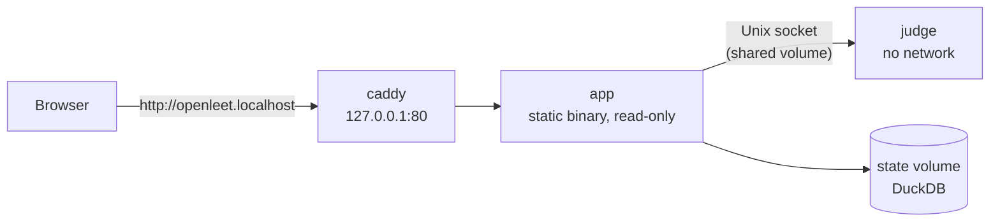

# Development

## Run the full stack



```bash
docker compose up -d           # prebuilt images from ghcr.io
docker compose up -d --build   # or build both images from this checkout
```

## Work on the server or web app

You need [uv](https://docs.astral.sh/uv/), [Bun](https://bun.sh), the Rust toolchain in
`rust-toolchain.toml`, and Docker. The judge needs Linux, so on macOS only the judge runs in a
container:

```bash
uv sync && uv run openleet judge fetch && bun install && bun run build
docker compose --profile dev up -d judge-dev   # judge on 127.0.0.1:7777
JUDGE_SOCKET=tcp://127.0.0.1:7777 cargo run --release -p openleet
```

The first `cargo run --release` compiles DuckDB and takes a few minutes. The app is then at
<http://localhost:8080>. `bun run dev` serves the web app with hot reload on
<http://localhost:3000> and sends `/api` to the server on port 8080 (`API_URL` changes that).

Local progress goes to `data/openleet.duckdb`, with daily copies in `data/backups/`; both are
ignored by git. Stop the server and delete them to start over. Stop the judge with
`docker compose --profile dev down judge-dev`.

## Checks

CI runs the same checks as the pre-push hook. Install the hook with `uv run prek install`, or run
everything once:

```bash
uv run prek run --all-files --hook-stage pre-push
```

`openleet smoke` tests a running server over HTTP: reference solutions, wrong and crashing
variants, time and memory limits, sandbox escapes and bad requests. It restores the drafts it
changes, but its submissions stay in the history.

```bash
uv run openleet smoke --base-url http://localhost:8080 --allow-network
```

## Layout

```text
server/  Rust API and web server     judge/  judge daemon; judge/py is the Python sandbox
proto/   types shared by both        web/    React app
src/     Python data tools           data/   problems, approaches, judge specs
deploy/  systemd units and scripts   docs/   these pages
```
